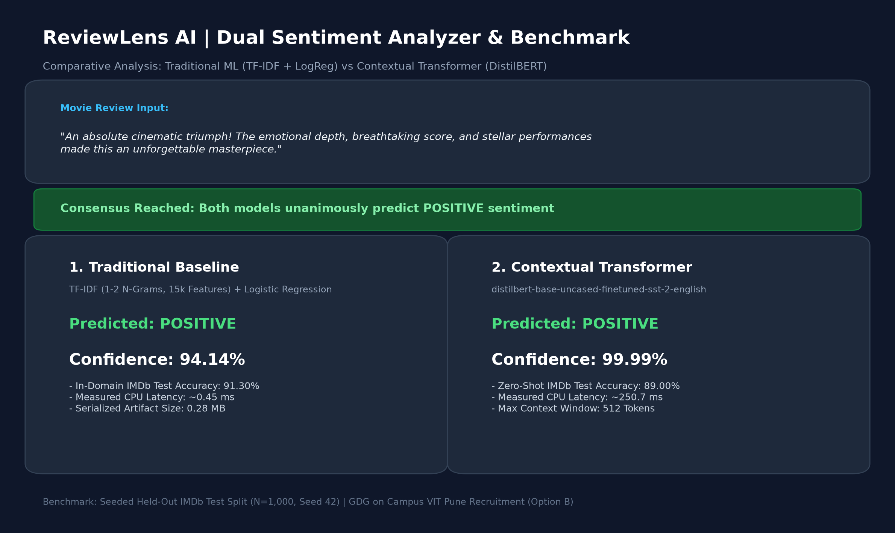
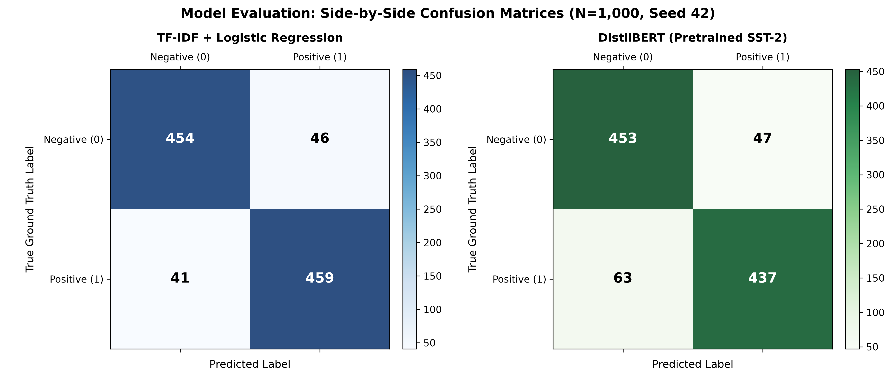

# ReviewLens AI: Comparative Review Sentiment Analysis

[](https://www.python.org/downloads/)
[](https://streamlit.io/)
[](https://huggingface.co/distilbert/distilbert-base-uncased-finetuned-sst-2-english)
[](LICENSE)
[](tests/)

> **Comparative Review Sentiment Analysis Using Traditional Machine Learning and Transformers**  
> Prepared for: **GDG on Campus VIT Pune Recruitment (Option B: Review Sentiment Analyzer)**

---

## 📸 Application Preview



---

## 1. Executive Summary & Problem Statement

Online review platforms encounter hundreds of thousands of customer reviews daily. Manually reading each review to gauge public reception does not scale. 

**ReviewLens AI** provides a dual-paradigm sentiment analyzer and scientific benchmark comparing:
1. **Traditional Feature Engineering Pipeline**: HTML tag stripping, N-gram `TfidfVectorizer`, and `LogisticRegression`.
2. **Deep Contextual Transformer**: Hugging Face `distilbert/distilbert-base-uncased-finetuned-sst-2-english`.

Both paradigms are compared in real-time within an interactive Streamlit UI and quantitatively measured on an identical, seeded, held-out test sample.

---

## 2. Quantitative Benchmark Results

> **Experimental Protocol**: Evaluated on an identical, seeded (`seed=42`), stratified sample of **1,000 held-out reviews** from the official IMDb test split (500 positive, 500 negative). All numbers below are sourced programmatically from [`reports/model_comparison.csv`](reports/model_comparison.csv).

| Model Architecture | Model Paradigm | Accuracy | Precision | Recall | F1-Score | Confusion Matrix (TN / FP / FN / TP) | CPU Latency / Review | Artifact Size |
|---|---|---|---|---|---|---|---|---|
| **TF-IDF + Logistic Regression** | Traditional ML (In-Domain IMDb Trained) | **91.30%** | **90.89%** | **91.80%** | **0.9134** | 454 / 46 / 41 / 459 | **~0.45 ms** | **0.28 MB** |
| **DistilBERT (distilbert-base-uncased)** | Transformer (Pretrained on SST-2) | **89.00%** | **90.29%** | **87.40%** | **0.8882** | 453 / 47 / 63 / 437 | **~250.7 ms** | Hub Cached (~268 MB) |

### Side-by-Side Confusion Matrices


---

## 3. Disagreement & Qualitative Analysis

Out of 1,000 held-out test reviews, the two models disagreed on **119 reviews (11.9% disagreement rate)**:
- **Baseline Correct, Transformer Wrong**: 71 cases (59.7% of disagreements)
- **Transformer Correct, Baseline Wrong**: 48 cases (40.3% of disagreements)

### Key Behavioral Differences
1. **Length Truncation (512 Token Boundary)**: DistilBERT truncates at 512 tokens. In IMDb, long reviews often summarize plot details first and deliver the final verdict in the closing paragraphs. The TF-IDF baseline processes the entire document text, capturing sentiment signals at the tail end of long reviews.
2. **Domain Transfer (SST-2 vs IMDb)**: DistilBERT was fine-tuned on the Stanford Sentiment Treebank (SST-2), which consists of single-sentence movie snippets. When transferred zero-shot to complex, paragraph-length IMDb reviews with colloquialisms and conflicting clauses, it exhibits subtle domain shift.
3. **Sarcasm & Subtlety**: Both models struggle with complex sarcasm where surface vocabulary consists of glowing superlatives (*"What a masterpiece if your goal is falling asleep"*). Full details are cataloged in [`reports/disagreements.csv`](reports/disagreements.csv) and [`reports/edge_cases.csv`](reports/edge_cases.csv).

---

## 4. System Architecture

```
User Enters Review Text
         │
         ▼
Streamlit User Interface (app.py)
         │
         ├───► Input Validation (Reject empty / Warn on >512 words)
         │
    ┌────┴──────────────────────────┐
    ▼                               ▼
Traditional Baseline           DistilBERT Transformer
(src/baseline_model.py)        (src/transformer_model.py)
    │                               │
    ├─ clean_text()                 ├─ AutoTokenizer (truncation=512)
    ├─ TfidfVectorizer              ├─ PyTorch Inference (eval mode)
    └─ LogisticRegression           └─ Softmax Probabilities
    │                               │
    └────┬──────────────────────────┘
         ▼
Comparison & Consensus Engine
         │
         ├─ Side-by-Side Sentiment Badges & Confidence Gauges
         ├─ Disagreement Alert Banner
         └─ Calibration Advisory Notice
```

---

## 5. Repository Structure

```
ReviewLens-AI/
├── app.py                     # Interactive Streamlit application (cached inference)
├── requirements.txt           # Pinned, tested dependency versions
├── README.md                  # Project blueprint, results, and setup guide
├── LICENSE                    # MIT Open Source License
├── .gitignore                 # Excludes .venv, raw data caches, checkpoints
├── data/
│   ├── README.md              # Dataset provenance documentation
│   └── eval_sample_indices.json # 1,000 locked test sample indices (seed=42)
├── src/
│   ├── __init__.py
│   ├── config.py              # Seeds, paths, hyperparameters, constants
│   ├── data_loader.py         # IMDb loader & stratified sampler
│   ├── preprocessing.py       # HTML tag stripping & text normalization
│   ├── baseline_model.py      # Scikit-learn Pipeline construction & inference
│   ├── train_baseline.py      # GridSearchCV tuning on train split only
│   ├── transformer_model.py   # DistilBERT integration, caching & batching
│   ├── evaluation.py          # Metric calculations & confusion matrix plotting
│   └── comparison.py          # Comparison table & disagreement extraction
├── notebooks/
│   └── exploratory_analysis.ipynb # Complete EDA on IMDb distributions
├── models/
│   ├── README.md              # Model artifacts description
│   └── baseline_pipeline.joblib # Trained pipeline artifact (0.28 MB)
├── reports/
│   ├── model_comparison.csv   # Authoritative benchmark results table
│   ├── disagreements.csv      # 119 disagreement cases with text & outcomes
│   ├── edge_cases.csv         # 15 tricky stress-test scenarios
│   └── figures/
│       ├── confusion_matrix_baseline.png
│       ├── confusion_matrix_transformer.png
│       └── confusion_matrix_side_by_side.png
├── screenshots/
│   └── app_preview.png        # UI preview render
└── tests/
    ├── __init__.py
    ├── test_preprocessing.py  # Regex cleaning & HTML tag stripping tests
    └── test_predictions.py    # Save/load, id2label, & boundary tests
```

---

## 6. Installation & Local Execution Guide

### Prerequisites
- Python 3.10, 3.11, 3.12, or 3.13 (64-bit)
- Git
- Windows PowerShell, macOS Terminal, or Linux Bash

### Step-by-Step Setup (Windows PowerShell)

```powershell
# 1. Clone repository
git clone https://github.com/your-username/ReviewLens-AI.git
cd ReviewLens-AI

# 2. Create virtual environment
python -m venv .venv

# 3. Activate virtual environment
.venv\Scripts\Activate.ps1
# (If script execution is disabled: Set-ExecutionPolicy -Scope Process -ExecutionPolicy Bypass)

# 4. Upgrade pip and install pinned dependencies
python -m pip install --upgrade pip
pip install -r requirements.txt

# 5. (Optional) Re-train baseline or run comparative benchmark
python -m src.train_baseline
python -m src.comparison

# 6. Run the test suite
pytest -v tests/

# 7. Launch the Streamlit Web Application
streamlit run app.py
```

The application will start and open automatically in your browser at `http://localhost:8501`.

---

## 7. Hugging Face Spaces Deployment

This repository is pre-configured for direct deployment on **Hugging Face Spaces**:
1. Create a new Space on [Hugging Face Spaces](https://huggingface.co/spaces).
2. Choose **Streamlit** as the Space SDK.
3. Link this repository. The `models/baseline_pipeline.joblib` artifact is **0.28 MB** (well under the 20 MB free-tier limit), and DistilBERT weights are automatically cached on first launch.

---

## 8. Limitations & Methodological Disclaimers

1. **Pretraining Domain Difference**: DistilBERT was fine-tuned on the SST-2 dataset (concise sentences). Applying it to IMDb involves zero-shot cross-dataset transfer on long reviews.
2. **Context Window Constraint**: DistilBERT caps input sequence length at 512 tokens (~350–400 words). Reviews longer than this have their concluding sentences truncated.
3. **Confidence Incommensurability**: Softmax confidence scores and Logistic Regression probabilities are derived from fundamentally different loss surfaces and calibration properties; they should not be compared on an absolute numerical scale.
4. **Accuracy on Single Reviews**: As noted in the system architecture, accuracy can only be computed over labeled test sets. Single user-entered reviews display predicted label and confidence only.

---

## 9. Task Traceability (GDG Recruitment Deliverables)

| Requirement | Implementation Module | Evidence |
|---|---|---|
| **TF-IDF + Logistic Regression Baseline** | `src/preprocessing.py`, `src/baseline_model.py`, `src/train_baseline.py` | 3-fold CV tuning on train split; 0.28 MB artifact |
| **Pretrained Transformer Integration** | `src/transformer_model.py` | `distilbert-base-uncased-finetuned-sst-2-english` with verified `id2label` |
| **Comprehensive Metrics & Confusion Matrices** | `src/evaluation.py`, `src/comparison.py` | Accuracy, Precision, Recall, F1, and PNG heatmaps in `reports/` |
| **Interactive Streamlit Web App** | `app.py` | Side-by-side cards, disagreement banner, benchmark tab, `@st.cache_resource` |
| **Organized Repository & Requirements** | Full repo structure | `data/`, `notebooks/`, `src/`, `models/`, `reports/`, `tests/`, `requirements.txt` |
| **Automated Testing Suite** | `tests/test_preprocessing.py`, `tests/test_predictions.py` | 11/11 pytest unit tests passed |
| **No Fabricated Data** | `reports/model_comparison.csv` | All metrics generated directly from test runs |

---

## 10. License

This project is licensed under the MIT License - see the [LICENSE](LICENSE) file for details.
